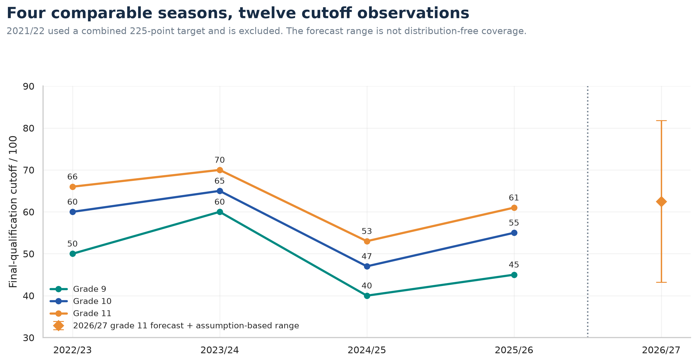
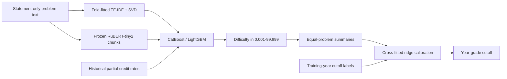
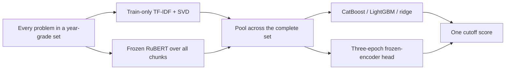
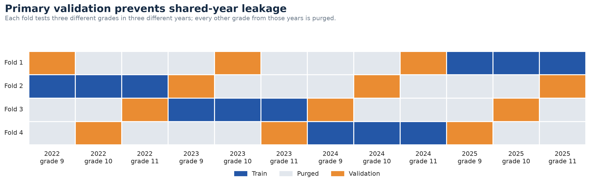
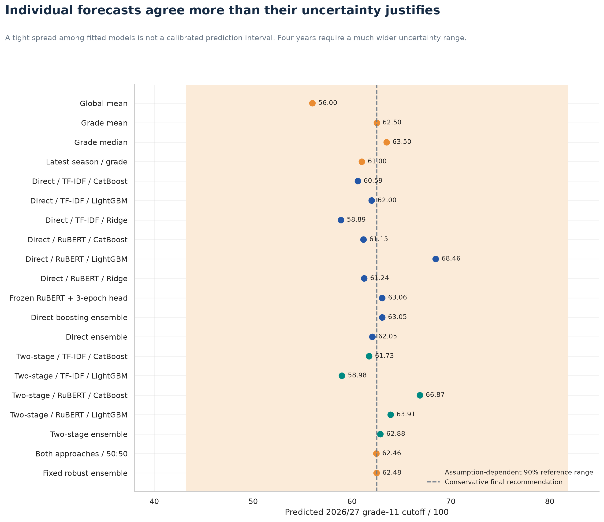

# DANO cutoff research

**Can problem text predict the score needed to reach the DANO final?**

This project downloads the complete linked official problem archive, measures
problem difficulty from anonymous historical scoring aggregates, and compares
two-stage and direct prediction under whole-year leakage controls. All model
training and inference run locally.

> **2026/27, grade 11: approximately 63/100.** The conservative point estimate is
> **62.5**; the fixed ensemble predicts **62.48**. A stationary-year, Student-t
> reference prediction interval is **43.2–81.8**. Four comparable seasons do not
> establish narrow, distribution-free uncertainty or high predictive precision.



## What was collected

The [official archive](https://dano.hse.ru/library/past_tasks) covers five
completed seasons, 2021/22–2025/26. The local collection contains **44 archive
problem PDFs**, plus four demonstration problem PDFs, solutions, rubrics,
result workbooks and linked project data: **136 manifest entries**, with all
131 directly linked file assets downloaded and five data pages retained.
Three malformed official links were repaired transparently in the manifest.

The comparable final-qualification cutoffs are the minimum **second-stage
prizewinner** scores, not the winner thresholds or final-round diploma scores.
The [official results](https://dano.hse.ru/result) give:

| Season | Grade 9 | Grade 10 | Grade 11 |
|---|---:|---:|---:|
| 2022/23 | 50 | 60 | 66 |
| 2023/24 | 60 | 65 | 70 |
| 2024/25 | 40 | 47 | 53 |
| 2025/26 | 45 | 55 | 61 |

In 2021/22, the workbook invitation boundary is **102 out of 225**, for each
grade, using **both** qualifying stages. Non-invitees top out at 101. That
different target is retained separately and excluded from cutoff regression.
Its second-stage item outcomes can train the auxiliary difficulty model.

The training corpus has **291 distinct year–grade–problem difficulty labels**,
291 historical statement variants, and the 30 problems in the supplied 2026
PDF. The statement variants share pooled outcome labels; they are not extra
independent observations. Full provenance, alignment and exclusions are in
[data documentation](docs/DATA.md), the [source index](docs/SOURCES.md), and
[source_manifest.json](data/processed/source_manifest.json).

Raw PDFs, participant workbooks, supplied-PDF fingerprints and per-problem
source metadata, frozen weights and fitted models remain local
and are ignored by Git. The repository contains collection code, anonymous
aggregates, configurations, measured outputs and all figures.

## Two approaches

### 1. Predict difficulty, then the cutoff



Difficulty is `clip(100 × (1 − mean earned/max points), 0.001, 99.999)`.
Calibration training features come from difficulty fits that exclude that
entire training season. This avoids fitting the cutoff calibrator on
in-sample difficulty estimates. Four first-stage combinations are compared:
TF-IDF or frozen RuBERT, each with CatBoost or LightGBM.

### 2. Predict the cutoff directly



No set is reduced to the first transformer window. All problem tokens are
processed through overlapping windows and every problem contributes to the
set representation. Semantic features are combined with grade, problem count,
text statistics and interpretable topic indicators.

There are only **12 cutoff labels**. Full-encoder fine-tuning would be poorly
supported, so the transformer remains frozen. The project compares frozen
embeddings with tree models, ridge and a trainable three-epoch regression head.
See [methods](docs/METHODS.md) and [model card](docs/MODEL_CARD.md).

## Validation and metrics

The primary protocol uses four cyclic diagonal folds. Each validates grade 9,
10 and 11 from **three different seasons**, and purges every other grade of
those seasons. With four comparable years, just one year—three cutoff
labels—remains for training. This severity is reported rather than hidden.

The supplementary protocol validates one year-grade case per fold and removes
its entire year; three training years remain. A forward-only sensitivity trains
on strictly earlier years. Every architecture uses identical cases and splits.
Year clusters, rather than twelve supposedly independent samples, drive the
uncertainty analysis.



Vocabulary, IDF, SVD, scaling, supervised difficulty fits and calibration are
isolated inside the training fold. Encoder weights are externally pretrained
and frozen. Fixed iteration counts prevent outer-label early stopping. No
hyperparameter or ensemble-weight search uses the reported validation labels.
The [preregistered commitments](docs/PREREGISTRATION.md) and
[validation details](docs/VALIDATION.md) describe the safeguards.

The custom metric is

$$
\operatorname{PowerLoss}_{1.5}=\frac1n\sum_i |y_i-\hat y_i|^{1.5}.
$$

Errors of 1, 2 and 10 score points incur penalties 1, 2.828 and 31.623.
MAE, RMSE, signed bias and maximum absolute error are reported alongside it.
Boosting uses squared-error training; the custom metric evaluates selection
and comparisons. Metric units are score-points raised to 1.5.

## Results

Selected supplementary whole-year-purged results:

| Model | Power loss ↓ | MAE ↓ | RMSE ↓ |
|---|---:|---:|---:|
| Frozen RuBERT + LightGBM, direct | 18.282 | 6.649 | 7.171 |
| Direct boosting ensemble | 22.633 | 7.387 | 8.482 |
| Grade-mean baseline | 24.736 | 7.778 | 9.080 |
| Direct ensemble | 26.632 | 8.338 | 9.361 |
| Two-stage difficulty ensemble | 35.484 | 9.655 | 11.619 |

Explicitly modeling difficulty **does not improve this benchmark**. The best
direct model's advantage is uncertain: its paired whole-year bootstrap loss
difference relative to the grade mean has a descriptive 95% interval spanning
zero. Looking across several architectures also creates selection optimism.

The fixed robust ensemble is 50% grade mean, 25% direct ensemble and 25%
two-stage ensemble. A training-only nested choice between the grade mean and
that fixed ensemble favors the grade mean for the final recommendation. It
does not discard the individual-model forecasts or claim that the baseline is
proven optimal.

| 2026/27 grade 11 forecast | Score |
|---|---:|
| Conservative recommendation: grade mean | **62.50** |
| Best supplementary individual: direct RuBERT + LightGBM | 68.46 |
| Direct boosting ensemble | 63.05 |
| Direct ensemble | 62.05 |
| Difficulty ensemble | 62.88 |
| Fixed robust ensemble | **62.48** |



The [full research results](docs/RESULTS.md) contain every architecture, all
three validation protocols, learning curves, error distributions, feature
importance, difficulty analysis, ensemble comparisons and uncertainty.
An [HTML report](reports/research_report.html) opens locally without a server.
Machine-readable [metrics](results/metrics.csv),
[every validation prediction](results/validation_predictions.csv),
[every current forecast](results/forecast_2026.csv), and
[the final prediction record](results/final_prediction.json) accompany it.
The [interpretation](docs/ANALYSIS.md) examines overfitting, changing model
rankings, feature importance and the evidence behind the conservative forecast.

## Reproduce locally

Requirements: Python 3.12, `uv`, and Poppler (`pdftotext`; install with
`brew install poppler` on macOS). The source PDF supplied by the user must be
available locally. Commands below run from the repository root.

```bash
uv sync --locked
uv run python -m dano.collect
mkdir -p data/raw/current
cp /path/to/this_year.pdf data/raw/current/2026_second_stage_user.pdf
uv run python -m dano.dataset
uv run python -m dano.embeddings --download-only
uv run python -m dano.embeddings
uv run python -m dano.benchmark
uv run python -m dano.report
uv run python -m dano.replay
uv run pytest -q
```

Collection and the first weight download require internet access. Training,
embedding inference, replay and reporting are local. RuBERT is pinned to an
exact Hugging Face revision with file hashes. The environment is locked in
[uv.lock](uv.lock); the seed, iterations and all hyperparameters live in
[benchmark.json](configs/benchmark.json). See
[reproducibility notes](docs/REPRODUCIBILITY.md) for cached replay and input
hashes. The validated input PDF SHA-256 is recorded in the local extraction
audit. The published replay summary contains model counts and numeric replay
agreement, without the supplied PDF's fingerprint.

## Repository map

```text
configs/                 Fixed experiment parameters
src/dano/                Collection, alignment, features, training, reporting, replay
tests/                   Metric, partition, answer-removal and data-isolation checks
data/processed/          Anonymous aggregates, provenance and extraction audits
results/                 Measured metrics, predictions, curves and replay check
figures/                 15 publication-quality figures in PNG and SVG
docs/                    Data, methods, validation, results and model limitations
reports/                 Local HTML research report
data/raw/                Downloaded source assets and supplied PDF (local, ignored)
models/                  Local fitted models and caches (ignored)
```

Code is MIT-licensed. Downloaded source documents and external model weights
retain their respective owners' terms. No participant identities are included
in the repository.
