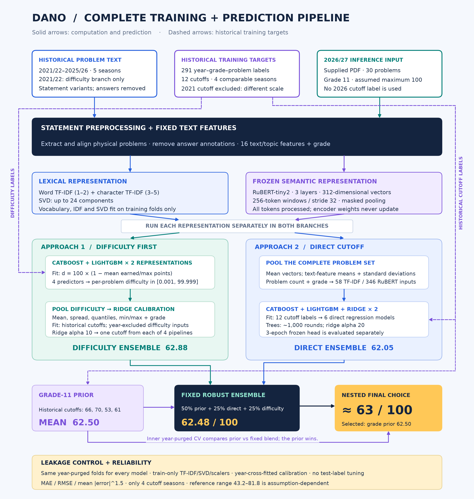

# Final architecture: inputs, training and prediction

**2026/27 grade 11 forecast: approximately 63/100.** The selected estimator
predicts **62.50**, and the fixed robust ensemble predicts **62.48**. These
are estimates; the official cutoff has not been verified in this project.



[Scalable SVG](../figures/end_to_end_pipeline.svg) ·
[Forecast table](../figures/grade11_forecast_table.png) ·
[Every measured model forecast](../results/forecast_2026.csv)

## 1. What enters the pipeline

| Input | What it contains | How it is used |
|---|---|---|
| Historical second-stage statements | All three variants in each of five seasons, 2021/22–2025/26 | Statement text for feature extraction; 2021/22 is auxiliary data for difficulty prediction only |
| Anonymous historical item outcomes | 291 distinct year–grade–physical-problem labels across grades 9–11 | Supervised targets for the problem-difficulty regressors |
| Historical qualification cutoffs | 12 labels: four comparable seasons × three grades | Targets for direct models and difficulty-to-cutoff calibration; also define the grade prior |
| Supplied 2026/27 PDF | 30 problem statements, with grade 11 supplied as an explicit feature | Inference only: no 2026 difficulty outcomes or cutoff label are used for training |

The 2021/22 cutoff is excluded: invitations used a combined 225-point result.
Its observed item outcomes remain useful auxiliary supervision after dividing
earned points by each physical problem's maximum. Participants' identities
are not model features. Raw files and supplied-PDF source metadata remain local.

## 2. How texts become numerical model inputs

First extract physical statements, align scoring subparts, remove answer
annotations and correct-choice markers, and calculate 16 fixed text/topic
features. Grade is supplied separately. Each representation is evaluated on
its own; TF-IDF and RuBERT are not concatenated into a single mixed encoder.

| Representation | Feature construction | What is trained |
|---|---|---|
| TF-IDF + SVD | Word 1–2-grams and character 3–5-grams; up to 3,000 features each; projection to up to 24 dimensions | Vocabulary, IDF and SVD fit only the allowed training-fold statements |
| Frozen RuBERT-tiny2 | Three transformer layers, width 312; overlapping windows of 256 tokens with stride 32; masked token pooling, then weighted window pooling and normalization | Encoder weights stay frozen; only the downstream predictors or the separate regression head are trained |
| Text/topic statistics | Length, digits, mathematical symbols, question count, Latin fraction, and probability/statistics/hypothesis/ML/data/visual/economics indicators | Fixed feature rules; scalers fit on training rows where needed |

Every problem contributes. Long statements are processed through multiple
windows rather than truncating an entire paper to its first 512 tokens.
Raster diagrams and some formula images remain outside the native-text input.

## 3. Approach 1: supervised problem difficulty, then the cutoff

For a physical problem and year-grade cohort, the observed target is
`clip(100 × (1 − mean(earned/max points)), 0.001, 99.999)`.
Higher values mean less partial credit earned by that cohort. Statement
variants share a pooled outcome label, with total sample weight one per
physical problem and grade.

Train **CatBoost and LightGBM for each of the two representations**: four
problem-difficulty predictors, with approximately 1,000 boosting rounds.
Full-fit input dimensions are 41 for TF-IDF (24 + 16 + grade) or 329 for
RuBERT (312 + 16 + grade).

For every set, average variant predictions within each physical problem.
Create eight calibration inputs: `100 − mean difficulty`, difficulty standard
deviation, 10th/50th/90th percentiles, minimum, maximum, and grade minus 10.
Each problem receives equal weight because the current PDF provides no point
weights.

For each of the four first-stage models, fit **StandardScaler + ridge,
alpha 10**, from those summaries to historical cutoff scores. Every training
year's summaries are produced by a difficulty model that excludes that whole
year. At inference, the difficulty model is refitted on all permitted
historical data and supplies the 2026 summaries to the fitted calibrator.

The mean of the four resulting cutoff forecasts is **62.88** for grade 11.

## 4. Approach 2: direct cutoff regression

For the complete set, pool mean representation vectors, means and standard
deviations of the 16 text features, physical-problem count, and grade minus 10.
The full-fit direct model sees **58 TF-IDF inputs** or **346 RuBERT inputs**.

Train **CatBoost, LightGBM and ridge for each representation**: six direct
models, each predicting a single cutoff. CatBoost and LightGBM use the
1,000-round budget; standardized ridge uses alpha 20. The direct ensemble is
the equal mean of those six models: **62.05** for grade 11.

A separate experiment trains a zero-initialized linear head on frozen RuBERT
set features for three epochs. It predicts grade-prior residuals using AdamW
and produces **63.06**. The encoder is not fine-tuned; this head is reported
separately and is not included in the direct ensemble.

## 5. The ensemble and the actual final selection

| Candidate or output | Definition | Grade-11 prediction |
|---|---|---:|
| Grade prior | Mean of grade-11 cutoffs 66, 70, 53 and 61 | **62.50** |
| Direct ensemble | Equal mean of six direct models | **62.05** |
| Difficulty-first ensemble | Equal mean of four complete two-stage pipelines | **62.88** |
| Fixed robust ensemble | 50% grade prior + 25% direct ensemble + 25% difficulty-first ensemble | **62.48** |
| Selected final estimate | Training-only nested year-purged choice between the grade prior and the fixed robust ensemble | **62.50 ≈ 63** |

The final selector favors the grade prior. The diagram makes that choice
explicit: the recommendation is not presented as a transformer-only forecast.
The complex branches quantify sensitivity and test whether text improves
historical prediction. The strongest individual model in supplementary
validation, direct RuBERT + LightGBM, predicts 68.46, but its apparent advantage
is uncertain and the forward-validation ranking changes.

## 6. What prevents leakage and limits confidence

All methods use identical validation cases. The primary folds validate three
different grades from three different years, removing every other grade of
those years from training. Supplementary folds hold out one case and purge
its whole year. Forward sensitivity trains only on earlier years.

Vocabulary, IDF, SVD, scaling, difficulty supervision and calibration remain
inside training folds. The custom score is mean absolute error raised to 1.5;
MAE and RMSE are reported too. Ensemble weights are fixed, and no outer-label
early stopping is used.

Only four comparable cutoff seasons exist. The **43.2–81.8** reference interval
assumes stationary, independent, approximately Gaussian year effects; its 90%
coverage is not validated for DANO. The current 30-problem format and missing
point weights add uncertainty. See [the analysis](ANALYSIS.md) and
[validation methodology](VALIDATION.md).

## Regenerate these visuals

```bash
uv run python -m dano.overview
```

The script reads the saved prediction and aggregate-label files. It renders
both PNG and SVG versions without refitting models or altering predictions.
